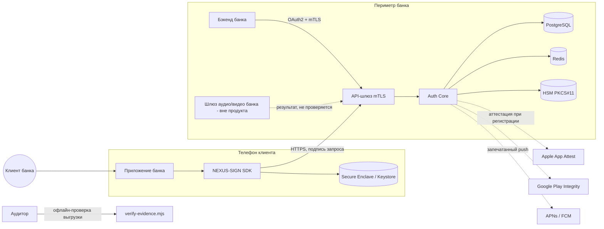
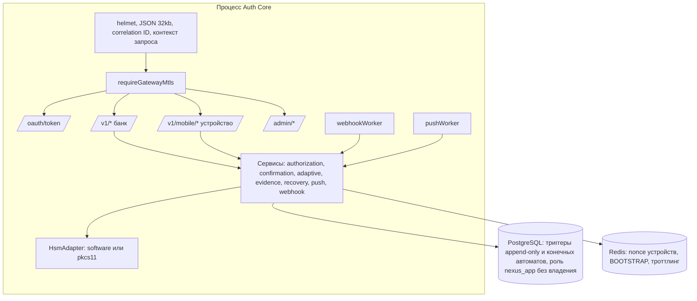
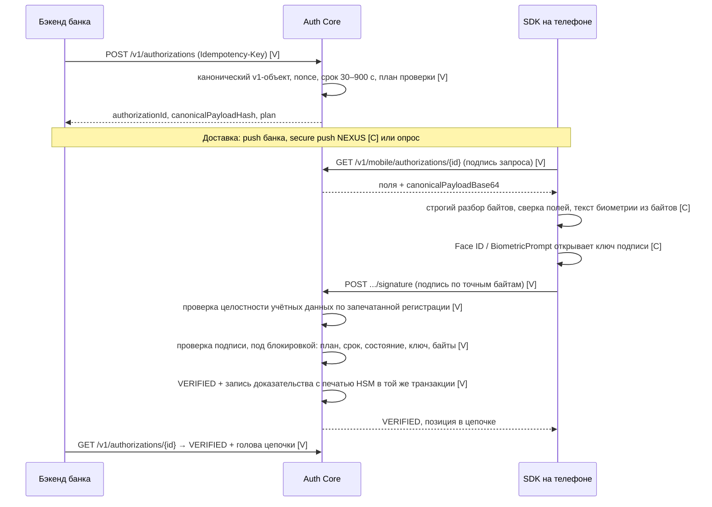
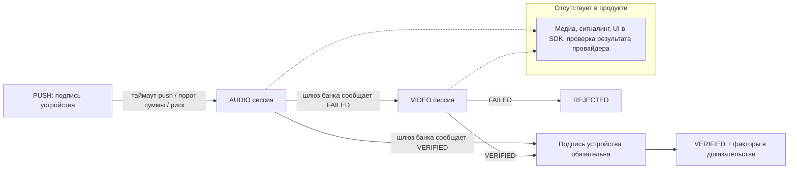
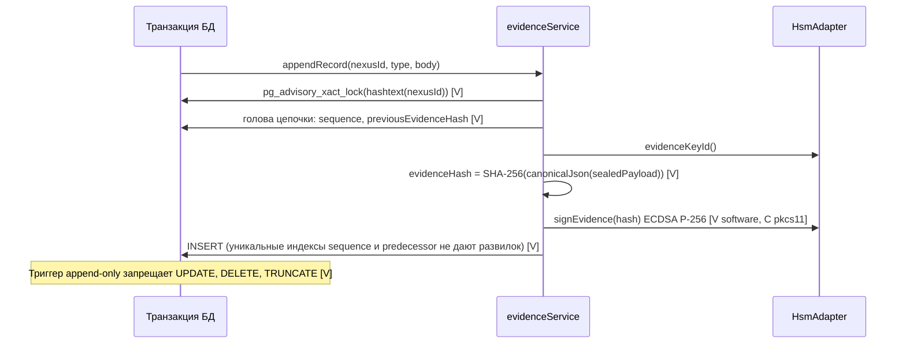
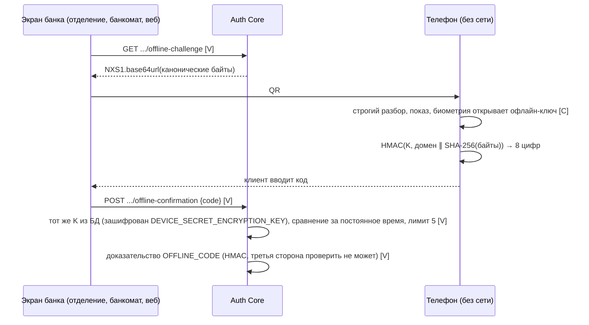
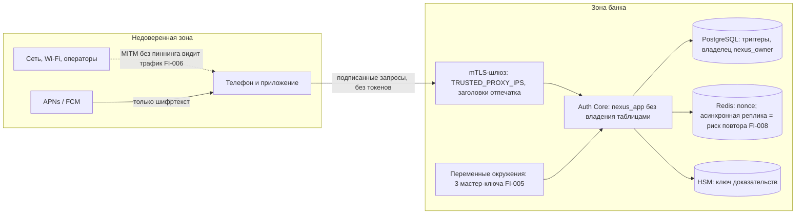

# 03. Архитектура и потоки данных (фаза 2)

Схемы восстановлены по исходному коду, а не по целевой архитектуре. Пометки на схемах:

- **[V]**: поведение проверено в этом аудите исполнением (unit, integration, e2e, демо-имитатор);
- **[C]**: найдено в коде, но не исполнялось;
- **[M]**: отсутствует.

## Компоненты

| Компонент | Ответственность | Точка входа | Аутентификация | Хранит | Режимы отказа | Статус |
|---|---|---|---|---|---|---|
| Auth Core API | Идентичности, устройства, подтверждения, доказательства, эскалация, push, вебхуки | `src/server.ts`, `src/app.ts` | Банк: OAuth2 client credentials, привязка к сертификату mTLS-шлюза. Устройство: подпись запроса аппаратным ключом. Регистрация: одноразовый BOOTSTRAP-токен | PostgreSQL (15 таблиц), Redis (nonce, токены, троттлинг) | Отказ БД, Redis или HSM → `/readyz` 503; HSM-таймаут 5 с | V |
| Webhook worker | Доставка событий банку с HMAC, повторы | `workers/webhookWorker.ts` | HMAC по секрету клиента | `webhook_deliveries` | Повторы, `SKIP LOCKED` | V (unit) |
| Push worker | APNs/FCM, таймауты push → эскалация | `workers/pushWorker.ts` | APNs JWT, Google OAuth | `push_messages` | Повторы, таймауты | C (без реальных APNs/FCM) |
| HSM adapter | Подпись печатей доказательств, проверка подписей | `crypto/selectHsmAdapter.ts` | PIN PKCS#11 | Ключ доказательств в HSM | Таймаут, пул сессий | Программный: V; PKCS#11: C |
| Админ-консоль | Управление, четыре глаза, аудит | `routes/admin.ts`, `public/admin` | Пароль (scrypt) и TOTP, cookie-сессия | `admin_users`, `admin_approvals`, `audit_logs` | — | V |
| iOS SDK | Ключи в Secure Enclave, Face ID, строгий разбор подписываемых байтов, подпись, офлайн, восстановление, secure push | `NEXUSSignSDK.swift` | Подпись запросов | Keychain | — | C |
| Android SDK | То же: Keystore/StrongBox, BiometricPrompt | `NEXUSSignSDK.kt` | Подпись запросов | Android Keystore, SharedPreferences | — | C (JVM-тесты на заглушках) |
| Демо-банк | Бэкенд банка для демо | `demo/bank-backend/demo-bank.mjs` | Нет на порту устройства (FI-016) | В памяти | — | V |
| Песочница | Эталонная реализация протокола | `sandbox/server/main.py` | Коды доступа | Файлы | — | V |

Внешние зависимости:

- Apple App Attest (корневой сертификат закреплён в продуктиве).
- Google Play Integrity (decode API).
- Список статусов аттестации Android: файл, который обновляют операторы.
- APNs и FCM: только транспорт запечатанных сообщений.
- Мобильные приложения не обращаются ни к каким внешним сервисам, кроме Auth Core.

## 1. Системный контекст

Статусы: Auth Core, PostgreSQL и Redis — [V]. HSM PKCS#11 — [C]. Apple, Google, APNs и FCM — [C]. Медиа аудио/видео — [M].

## 2. Архитектура исполнения

## 3. Подтверждение транзакции

Ограничения:

- Состояние `PENDING_USER` сохраняется после истечения срока, пока не будет попытки подтверждения (FI-013, проверено).
- Видимость IBAN в системном окне подтверждения требует проверки на устройстве (FI-003).

## 4. Регистрация устройства и жизненный цикл учётных данных

```mermaid
stateDiagram-v2
  [*] --> NoCredential
  NoCredential --> Bootstrap: банк выдаёт BOOTSTRAP 300 с [V]
  Bootstrap --> Active: POST /v1/mobile/bootstrap, ключи подписи, аутентификации и офлайн, аттестация [V]; аттестация в продуктиве обязательна [C]
  Active --> Active: подписанные запросы, nonce однократен [V]
  Active --> Revoked: отзыв банком / админом (четыре глаза) [V]
  Active --> Revoked: замена устройства (REPLACEMENT после переидентификации) [V]
  Active --> Revoked: восстановление по фразе на новом устройстве [V]
  Revoked --> [*]
  note right of Active
    Один ACTIVE на NEXUS ID (уникальный индекс) [V]
    Ключи неизменяемы (триггер) [V]
    Регистрация запечатана в цепочке (CREDENTIAL_ENROLLED) [V]
  end note
```

## 5. Эскалация PUSH → AUDIO → VIDEO

Проверено [V]: порядок эскалации, отказ в понижении, требование подписи после AUDIO и VIDEO, запись факторов в доказательство.

Отсутствует [M]: сам аудио- и видеоканал, а также проверка подлинности результата (FI-001, FI-002).

## 6. HSM и создание доказательств

## 7. Офлайн-подтверждение по QR

## 8. Восстановление и замена устройства

```mermaid
flowchart TB
  subgraph Setup[Настройка на зарегистрированном устройстве]
    S1[GET /v1/mobile/recovery/setup: соль] --> S2[фраза 128 бит → PBKDF2 210k → HKDF → ключ обёртки]
    S2 --> S3[новая пара P-256, приватный ключ обёрнут AES-GCM]
    S3 --> S4[POST setup, подпись биометрическим ключом] --> S5[RECOVERY_CONFIGURED в цепочке]
  end
  subgraph Recover[Новое устройство]
    R1[банк переидентифицирует клиента, открывает сессию] --> R2[устройство получает обёрнутый ключ]
    R2 --> R3[фраза → ключ → подпись доказательства с новым ключом устройства]
    R3 --> R4[старый credential REVOKED, новый ACTIVE, CREDENTIAL_ENROLLED RECOVERY]
  end
  subgraph Replace[Замена без фразы]
    X1[банк: replacement method и reference] --> X2[BOOTSTRAP REPLACEMENT] --> X3[новая регистрация, старые отозваны, уведомление на старое устройство]
  end
```

Все три ветки — [V] (e2e и integration). Мобильная часть — [C].

## 9. Интеграция с банком и коммит транзакции

```mermaid
stateDiagram-v2
  [*] --> PENDING
  PENDING --> COMMIT_REQUESTED: POST bank-commit-request после VERIFIED, не старше BANK_COMMIT_MAX_AGE [V]
  COMMIT_REQUESTED --> COMMITTED: bank-commit-result [V]
  COMMIT_REQUESTED --> FAILED
  COMMIT_REQUESTED --> CANCELLED
  note right of COMMIT_REQUESTED: переходы закреплены триггером БД [V]; сверка с core banking отсутствует [M]
```

## 10. Обработка отказов и границы доверия

| Граница | Что её защищает | Что проверено |
|---|---|---|
| Телефон → Auth Core | ECDSA-подпись запроса аппаратным ключом, nonce в Redis, окно ±300 с | Повтор отклоняется [V] |
| Банк → Auth Core | OAuth2 + привязка токена к отпечатку сертификата шлюза | integration admin-audit-mtls [V] |
| Auth Core → БД | Роль без владения, триггеры, уникальные индексы | db-roles, state-machine [V] |
| Злоумышленник с правами записи в БД → решения | Сверка ключей с запечатанной регистрацией, печать HSM | evidence-integrity [V] |
| Оператор, владеющий мастер-ключом и БД | Не защищено для офлайн-кодов и push-ключей | FI-004, FI-005 |
