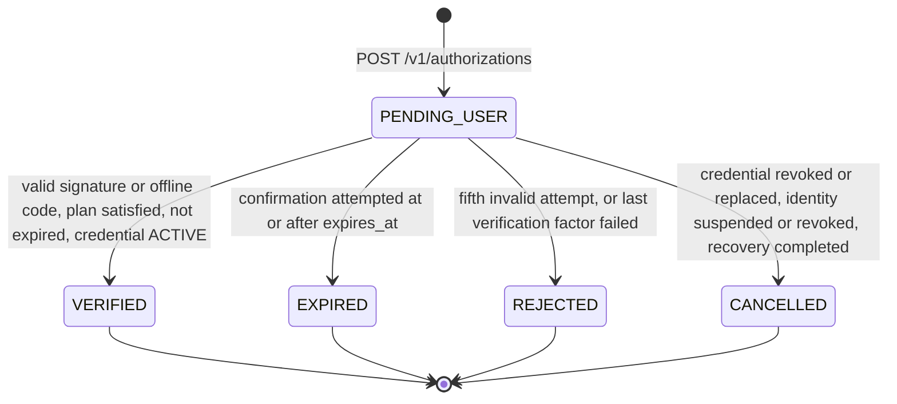

# Data model

Auth Core stores its state in PostgreSQL. The complete schema is `auth-core/src/db/schema.sql`; upgrades use `auth-core/migrations/` ([migrations guide](../../auth-core/migrations/README.md)). Auth Core connects as `nexus_app`, which may insert and read but not change `evidence_records` and `audit_logs`, and owns no table (`auth-core/scripts/db/roles.sql`, [database roles](../operations/deployment.md#database-roles)). Short-lived tokens, device request nonces, recovery setup salts and login throttle counters live in Redis and are not covered here.

## Tables

| Table | Purpose | Written by |
|---|---|---|
| `bank_clients` | Bank backends allowed to call this deployment and their client certificate fingerprints | `clientService.ts` (CLI `registerClient`) |
| `nexus_identities` | NEXUS IDs and their recovery configuration | `nexusIdentityService.ts`, `recoveryService.ts`, `evidenceService.ts` (`recovery_evidence_id`); `authorizationConfirmation.ts` sets `last_used_at` |
| `credentials` | Device credentials: signing key, authentication key, offline key material, link to the sealed enrolment | `credentialService.ts`, `recoveryService.ts`, `nexusIdentityService.ts` (revocation), `evidenceService.ts` (`enrolment_evidence_id`), CLI `sealCredentialBaseline`; `authorizationConfirmation.ts` sets `last_used_at` |
| `authorization_requests` | Transaction authorizations and their bank transaction state | `authorizationService.ts` (creation), `authorizationConfirmation.ts` (verification, expiry, rejection), `bankTransactionService.ts`; state `CANCELLED` from `credentialService.ts`, `nexusIdentityService.ts`, `recoveryService.ts`; state `REJECTED` from `adaptiveVerificationService.ts` |
| `authorization_attempts` | Every signature or offline-code attempt | `authorizationConfirmation.ts` |
| `authorization_verification_plans` | One adaptive verification plan per authorization | `adaptiveVerificationService.ts` |
| `verification_sessions` | Audio and video verification sessions | `adaptiveVerificationService.ts` |
| `evidence_records` | Sealed, numbered, hash-chained evidence per NEXUS ID: one record per `VERIFIED` authorization, per enrolled credential and per recovery setup | `evidenceService.ts` |
| `recovery_sessions` | Recovery sessions opened by the bank backend | `recoveryService.ts` |
| `webhook_deliveries` | Outbox of webhook events and their delivery state | `webhookService.ts` (enqueued by `bankTransactionService.ts`, `pushService.ts`, `credentialService.ts` and `recoveryService.ts`, delivered by `workers/webhookWorker.ts`) |
| `push_registrations` | APNs or FCM token and encrypted push key of a device credential | `pushRegistrationService.ts`; `pushService.ts` retires invalid tokens |
| `push_messages` | Outbox of secure push messages, sealed per device, and their delivery state | `pushService.ts` (queued by `POST /v1/push-messages`, `authorizationService.ts` and device replacement, delivered by `workers/pushWorker.ts`) |
| `audit_logs` | Security-relevant events, append-only | `auditService.ts`, called by every service above |
| `admin_users` | Accounts of the admin interface | `adminAuthService.ts` (CLI `createAdminUser`) |
| `admin_approvals` | Four-eyes requests to revoke or reactivate an identity | `adminApprovalService.ts` |

Service files are under `auth-core/src/services/`.

## bank_clients

Key columns: `client_id` (primary key), `client_secret_hash` (`scrypt$N$r$p$salt$hash`; the 1.4 format `scrypt$salt$hash` still verifies), `webhook_url`, `webhook_secret_encrypted` (AES-256-GCM with `WEBHOOK_SECRET_ENCRYPTION_KEY`; `v2$iv$tag$ciphertext` bound to the client ID, or the 1.4 format `iv$tag$ciphertext`), `status` (`ACTIVE`, `DISABLED`), `push_mode` (`BANK`: the bank's push system delivers authorization requests; `NEXUS`: Auth Core does, through secure push), `mtls_cert_sha256` (migration 016: array of lowercase hex SHA-256 fingerprints of the client certificates the gateway may present for this client; empty by default).

With `REQUIRE_MTLS_HEADER`, tokens are issued and accepted only when the gateway's fingerprint is in `mtls_cert_sha256`; a client with an empty array cannot obtain tokens. `setClientCertificates <clientId> <hex>[,<hex>]` replaces the array without touching the secrets; `registerClient --mtls-cert-sha256` also replaces it, and without the option keeps it.

A `DISABLED` client gets no tokens, its issued tokens and mobile tokens stop resolving, and its webhooks are not delivered. Neither the API nor a script sets `DISABLED`; it is an operator change in the database.

## nexus_identities

Key columns: `nexus_id` (nine digits, primary key), `client_id`, `bank_customer_ref`, `status`, `last_used_at`, and the recovery configuration:

| Column | Content |
|---|---|
| `recovery_protocol` | Migration 015. `2`, `1` (set up before 2.0; refused with `RECOVERY_PROTOCOL_RETIRED`), or empty (no recovery configured) |
| `recovery_public_key_pem` | Protocol 2: the recovery public key (P-256) |
| `recovery_wrapped_key` | Protocol 2: 60 bytes, `iv(12) \|\| AES-256-GCM(scalar) \|\| tag(16)`, under a key derived from the phrase |
| `recovery_kdf_salt`, `recovery_kdf_iterations` | PBKDF2 parameters of the phrase |
| `recovery_evidence_id` | Migration 013. The `RECOVERY_CONFIGURED` record the stored recovery key is checked against before a recovery |
| `recovery_updated_at` | Last setup |

`uq_nexus_identity_customer` allows one non-revoked identity per `(client_id, bank_customer_ref)`.

| `status` | Set by | Effect |
|---|---|---|
| `ACTIVE` | Creation; reactivation from `SUSPENDED` (admin) | Normal operation |
| `SUSPENDED` | Admin `suspend` | Open authorizations `CANCELLED`; mobile requests, new authorizations, confirmations and recovery refused |
| `REVOKED` | Admin `revoke`, from `ACTIVE` or `SUSPENDED` | All credentials `REVOKED`, open authorizations `CANCELLED`; final |

The stored values are not enough to complete a recovery without the phrase. Migration 018 dropped the protocol 1 verifiers (`recovery_verifier`), which worked as passwords; an identity on protocol 1 keeps `recovery_protocol = 1` and no recovery secret.

The trigger `identity_lifecycle` (migration 017) permits only `ACTIVE` to `SUSPENDED` or `REVOKED`, and `SUSPENDED` to `ACTIVE` or `REVOKED`; `REVOKED` is final. `nexus_id`, `client_id` and `bank_customer_ref` cannot change, and `recovery_evidence_id` cannot be cleared once set.

## credentials

Key columns: `credential_id`, `nexus_id`, `public_key_pem` (signing key, P-256), `key_algorithm` (`ES256`), `platform`, `security_level` (from the verified attestation when attestation succeeded: `SECURE_ENCLAVE`, `STRONGBOX`, `TEE`, `SOFTWARE`), `attestation_status` (`UNKNOWN`, `VERIFIED`, `FAILED`, `EXPIRED`), `state`, `key_version`, `auth_public_key_pem`, `offline_public_key_pem`, `offline_server_public_key_pem`, `offline_secret_encrypted`, `enrolment_evidence_id` (migration 013: the credential's `CREDENTIAL_ENROLLED` record).

Before a credential's keys are used, Auth Core compares `public_key_pem`, `auth_public_key_pem` and `offline_public_key_pem` with the keys sealed in the record `enrolment_evidence_id` names, and refuses the credential (audit `integrity_violation`) when the record is missing, does not verify or differs.

`offline_secret_encrypted` holds the per-credential offline key, encrypted with `DEVICE_SECRET_ENCRYPTION_KEY` and bound to the credential ID. A check constraint requires it and `offline_server_public_key_pem` to be both set or both empty.

| `state` | Meaning |
|---|---|
| `ACTIVE` | Set on creation by enrolment, replacement or recovery. Signs authorizations and, with `auth_public_key_pem`, device requests |
| `REVOKED` | Set by `POST /v1/credentials/{id}/revoke`, by device replacement, by recovery and by identity revocation. Its `PENDING_USER` authorizations are `CANCELLED` in the same transaction. Final |

Suspension is a state of the identity, not of the credential. A credential without `auth_public_key_pem` (enrolled by an SDK before 1.2) cannot call the mobile API.

The trigger `credential_lifecycle` (migrations 017 and 018) permits only `ACTIVE` to `REVOKED`. The keys, `nexus_id`, `platform`, `key_algorithm`, `key_version` and the offline key material cannot change, and `enrolment_evidence_id` is set once. The unique index `idx_credentials_one_active` allows one `ACTIVE` credential per identity.

Credentials are created only by enrolment (`POST /v1/mobile/bootstrap`) and recovery completion. Enrolment is refused with 409 `ACTIVE_CREDENTIAL_EXISTS` while the identity has an `ACTIVE` credential, unless the BOOTSTRAP token carries a replacement authorization; then the old credential is revoked in the same transaction. Recovery revokes the identity's `ACTIVE` credential. `key_version` increases with recovery.

## authorization_requests

Key columns: `authorization_id`, `client_id`, `nexus_id`, `credential_id`, the signed fields (`transaction_reference`, `operation_type`, `amount_minor`, `currency`, `beneficiary`, `policy_reference`, `policy_version`, `nonce`, `issued_at`, `expires_at`), `canonical_payload_hash`, `state`, `signature`, `signature_format` (`der`, `raw`, `hmac`), `confirmation_method` (`DEVICE_SIGNATURE`, `OFFLINE_CODE`), `verified_at`, `consumed_at`, `correlation_id`, `idempotency_key`, `bank_transaction_state`, `bank_transaction_reference`, `bank_commit_at`, `bank_commit_error`.

Unique indexes: `(client_id, transaction_reference)` and `(client_id, idempotency_key)`. `risk_context_reference` and `policy_decision` are defined and not written.

The trigger `authorization_lifecycle` (migration 017) refuses any change to `authorization_id`, `client_id`, `nexus_id`, `credential_id`, `transaction_reference`, `operation_type`, `amount_minor`, `currency`, `beneficiary`, `canonical_payload_hash`, `nonce`, `issued_at` and `created_at`; allows `signature`, `signature_format`, `confirmation_method` and `verified_at` to change only on the transition to `VERIFIED`; requires a signature and `verified_at` for `VERIFIED`; and freezes `expires_at` once the authorization is final.

### Authorization state

The lifecycles enforced by the database are specified in [state machines](../architecture/state-machines.md).



`VERIFIED`, `EXPIRED`, `REJECTED` and `CANCELLED` are final for Auth Core. The transition to `VERIFIED` runs in one transaction that locks the verification plan first, then the authorization, and re-checks the plan, the expiry, the credential state, the credential key and the canonical bytes. An escalation that commits concurrently wins. The column and the trigger (migration 018) accept only these five states and only transitions from `PENDING_USER`.

Expiry is applied when a confirmation is attempted. An authorization past `expires_at` that nobody tried to confirm keeps `PENDING_USER`.

### Bank transaction state

`bank_transaction_state` tracks what the bank reports for a `VERIFIED` authorization:

```text
PENDING -> COMMIT_REQUESTED -> COMMITTED | FAILED | CANCELLED
```

Each change enqueues a webhook event in the same transaction. The trigger permits `PENDING` to `COMMIT_REQUESTED` only while the authorization is `VERIFIED`, and `COMMIT_REQUESTED` to `COMMITTED`, `FAILED` or `CANCELLED`; `bank_transaction_reference` is set only with the commit request. Auth Core additionally requires the identity and the confirming credential to be `ACTIVE` and the confirmation to be within `BANK_COMMIT_MAX_AGE_SECONDS`.

## authorization_attempts

One row per attempt: `attempt_number`, `result` (`INVALID_SIGNATURE` or `VERIFIED` are written; the constraint also accepts `EXPIRED`, `REJECTED`, `CREDENTIAL_INVALID`), `reason_code` (`signature_verification_failed`, `malformed_signature`, `offline_code_invalid`), `source_ip`, `user_agent`. Invalid attempts are counted under a row lock on the authorization; the fifth rejects it.

## authorization_verification_plans

Key columns: `authorization_id` (primary key), `required_step`, `current_step`, `allowed_steps` (subsets of `PUSH`, `AUDIO`, `VIDEO`), `audio_enabled`, `video_enabled`, `push_timeout_seconds`, `high_amount_threshold_minor`, `client_escalation_allowed`, `status`, `last_escalation_reason`.

Created in the same transaction as the authorization. An idempotent replay returns the existing plan unchanged. `required_step` only increases.

| `status` | Set when |
|---|---|
| `PENDING` | Creation; after an escalation; after a factor that does not yet reach `required_step`; after a failed AUDIO check that escalates to VIDEO |
| `IN_PROGRESS` | An AUDIO or VIDEO session is opened |
| `VERIFIED` | A session reaches `required_step`, or a valid confirmation completes a PUSH-level plan |
| `FAILED` | The last available factor fails; the authorization becomes `REJECTED` |
| `EXPIRED`, `CANCELLED` | Accepted by the column; Auth Core does not set them. Expiry and cancellation are recorded on the authorization |

## verification_sessions

Key columns: `session_id`, `authorization_id`, `channel`, `nonce_hash` (SHA-256 of the session nonce; the nonce itself is not stored), `expires_at` (five minutes), `status`, `provider_reference`, `assertion_hash` (SHA-256 of the provider assertion), `completed_at`.

`status`: `IN_PROGRESS` on opening; `VERIFIED` or `FAILED` from the provider result; `EXPIRED` when a result arrives after `expires_at`; `CANCELLED` when a new session for the same authorization supersedes it.

## evidence_records

Key columns: `evidence_id`, `record_type`, `authorization_id` (unique, `AUTHORIZATION` records only), `nexus_id`, `credential_id`, `chain_sequence`, `sealed_payload` (schema 2 and 3), `evidence_hash`, `previous_evidence_hash`, `hsm_signature`, `hsm_key_version`, `seal_key_id`, `schema_version`, `verification_factors`, `created_at`. The remaining columns repeat fields of the sealed payload for queries.

Columns added by migration 013 (evidence schema 3):

| Column | Content |
|---|---|
| `record_type` | `AUTHORIZATION` (a confirmed transaction), `CREDENTIAL_ENROLLED` (the keys and attestation of an enrolled credential, with the reason `ENROLMENT`, `REPLACEMENT`, `RECOVERY` or `BASELINE`; chains written by 1.x and 2.0.0-rc.1 may also contain `ROTATION` and `BANK_PROVISIONED`) or `RECOVERY_CONFIGURED` (a registered recovery public key). A check constraint keeps the authorization columns required for `AUTHORIZATION` records |
| `chain_sequence` | Position in the identity's chain, from 1; sealed in schema 3 records. Records from before 013 were numbered by the migration in `created_at` order |
| `seal_key_id` | SHA-256 (hex) of the SubjectPublicKeyInfo of the HSM key that sealed the record; empty before schema 3 |

Unique indexes: `uq_evidence_chain_sequence (nexus_id, chain_sequence)`, `uq_evidence_chain_link (nexus_id, previous_evidence_hash)` for records with a predecessor, and `uq_evidence_chain_genesis (nexus_id)` for the first record, so a chain cannot fork or hold two records at one position. Records are appended under a per-identity advisory lock. Format and verification: [evidence format](../protocol/evidence-format.md). Records sealed before migration 009 have no `sealed_payload` and are reported as unsupported by the verifier.

## recovery_sessions

Key columns: `recovery_session_id`, `nexus_id`, `client_id`, `nonce`, `access_token_hash` (SHA-256 of the `rc_` token), `kdf_salt`, `expires_at` (600 seconds), `used_at`, `attempt_count`, and from migration 015 `protocol` (1 or 2, the identity's protocol when the session was opened), `failed_attempt_count` (failed proofs of this session) and `created_at`. A session is usable while `used_at` is empty, it has not expired and `attempt_count` is below five. A new session is refused (`RECOVERY_LOCKED`) while the sum of `failed_attempt_count` over the identity's sessions created in the last 24 hours is 10 or more (index `idx_recovery_sessions_identity_recent`).

## webhook_deliveries

Key columns: `event_id` (unique, sent as `eventId`), `client_id`, `event_type`, `payload`, `status` (`PENDING`, `DELIVERED`, `FAILED`), `retry_count`, `next_attempt_at`, `last_error`, `last_http_status`, `delivered_at`. A row is written only when the client has a webhook configured. After the fifth failed retry the row becomes `FAILED`. `event_created_at` and `delivery_attempt_id` are defined and not written.

## push_registrations

Key columns: `credential_id` (primary key; one registration per device credential), `provider` (`APNS`, `FCM`), `apns_environment` (`PRODUCTION`, `DEVELOPMENT`; set exactly for APNs), `device_token`, `push_key_encrypted` (the push key agreed with the device, encrypted with `DEVICE_SECRET_ENCRYPTION_KEY`, associated data `device:push:<credential ID>`), `push_key_id` (public ID of that key, compared at every token refresh), `status` (`ACTIVE`, `INVALID` after the provider rejected the token), `last_error`, `invalidated_at`. A token refresh updates the row and sets it `ACTIVE`; a new key agreement replaces the key and fails the credential's queued messages. `DELETE /v1/mobile/push-registration` deletes the row, and so does revoking or replacing the credential, in the same transaction.

## push_messages

Key columns: `message_id`, `client_id`, `nexus_id`, `credential_id` (the device the message is sealed for), `category`, `replacement_notice` (migration 014: the `SECURITY` notice to a replaced device; it is delivered although the credential is revoked, and the device's push registration is kept until it is sent), `authorization_id` (authorization requests), `message_reference` (unique per client when set), `envelope` (the AES-256-GCM envelope as JSON text; the plaintext is never stored), `status` (`QUEUED`, `SENT`, `DELIVERED`, `FAILED`, `EXPIRED`), `provider`, `provider_message_id`, `retry_count`, `next_attempt_at`, `expires_at`, `last_error`, `last_http_status`, `sent_at`, `delivered_at` (the device's receipt), `timeout_reported_at` (`push.timeout` sent). `envelope` is empty only for a message that failed before it could be sealed (`NO_PUSH_REGISTRATION`).

## audit_logs

Key columns: `event_id`, `timestamp`, `event_type`, `nexus_id`, `bank_customer_id`, `details`, `ip_address`, `user_agent`, and from migration 016:

| Column | Content |
|---|---|
| `client_id` | The bank the event belongs to: from the authenticated request, or derived from `nexus_id`. Empty for events not attributable to a bank (for example `oauth_token_rejected`, whose claimed client ID is unverified and kept in `details`) |
| `actor` | Who acted: `bank:<clientId>`, `device:<credentialId>`, `device-enrolment:<nexusId>`, `admin:<username>`, `cli:sealCredentialBaseline`; approved admin actions name both admins |

Source address, user agent, actor and bank are taken from the request context (`src/services/requestContext.ts`) unless the caller sets them. Event types are listed in `auth-core/src/types/index.ts` (`AuditEventType`); [incident response](../operations/incident-response.md#detection) describes the security-relevant ones. Inside a transaction the audit row commits or rolls back with the state change it describes. The triggers `audit_logs_no_update` and `audit_logs_no_truncate` reject `UPDATE`, `DELETE` and `TRUNCATE`. Index `idx_audit_logs_client_time (client_id, "timestamp")`. The admin interface reads the table through `/admin/api/audit-logs`, limited to the admin's bank.

## admin_users

Key columns: `username`, `password_hash` (`scrypt$N$r$p$salt$hash`, N=2^17; hashes from 1.4 are upgraded at the next login), `role` (`administrator`, `operator`, `auditor`), `status` (`ACTIVE`, `DISABLED`), `last_login_at`, and from migration 016:

| Column | Content |
|---|---|
| `client_id` | Empty: platform operator (all banks). Otherwise the one bank the account sees and acts on |
| `totp_secret_encrypted` | TOTP secret, AES-256-GCM with `ADMIN_SECRET_ENCRYPTION_KEY` and the associated data `admin:<username>` |
| `totp_last_step` | Last accepted TOTP time step; a code is accepted only for a later step |
| `session_version` | Increased by every `createAdminUser` run for the account; sessions issued under an earlier version end |

State changes in the admin interface need at least `operator`; `auditor` is read-only. Neither the API nor a CLI sets `DISABLED`; it is an operator change in the database.

## admin_approvals

Migration 016. One row per four-eyes request.

| Column | Content |
|---|---|
| `approval_id` | Primary key |
| `action` | `REVOKE` or `REACTIVATE` |
| `nexus_id`, `client_id` | The identity and its bank |
| `reason` | Up to 256 characters, from the requester |
| `requested_by`, `requested_at` | The requesting admin |
| `expires_at` | `requested_at` plus `ADMIN_APPROVAL_TTL_HOURS` |
| `status` | `PENDING`, `EXECUTED`, `REJECTED`, `EXPIRED` |
| `decided_by`, `decided_at` | The deciding admin; set together with any status other than `PENDING` |

Constraints: `admin_approvals_two_people` refuses `EXECUTED` unless `decided_by` is set and differs from `requested_by`; `admin_approvals_decided` ties `decided_at` to the status; `idx_admin_approvals_one_pending` allows one pending request per identity and action. Pending requests past `expires_at` are marked `EXPIRED` when approvals are next listed.

## Retention

- `evidence_records` and `audit_logs` are append-only. Triggers `trg_evidence_append_only` and `trg_evidence_no_truncate`, `audit_logs_no_update` and `audit_logs_no_truncate` reject `UPDATE`, `DELETE` and `TRUNCATE`; `nexus_app` cannot disable them. Retention is handled by export and archival (WORM storage or a SIEM) under `nexus_audit_reader`, not by deletion. The triggers do not stop a superuser or the table owner; for evidence, the seals, the chain numbering and the heads held by the banks make a later gap or substitution detectable.
- Auth Core deletes no rows, except a device's `push_registrations` row when the device unregisters from push or its credential is revoked or replaced. `scripts/db/roles.sql` grants `nexus_app` `DELETE` on `push_registrations` only. The `BEFORE DELETE` triggers of migration 017 (`recovery_sessions_no_delete`, `admin_approvals_no_delete`, `credentials_no_delete`, `identities_no_delete`, `authorizations_no_delete`, function `refuse_delete()`) refuse deleting rows of `recovery_sessions`, `admin_approvals`, `credentials`, `nexus_identities` and `authorization_requests` for every role, so that the recovery lockout, approval decisions and the rows referenced by sealed evidence are kept. Retention periods for authorizations, attempts, audit logs, sessions, webhook deliveries and push messages are set by the bank.
- `authorization_verification_plans` and `verification_sessions` reference `authorization_requests` with `ON DELETE CASCADE`; since migration 017 the delete trigger on `authorization_requests` refuses the delete itself. An authorization that has an evidence record cannot be deleted in any case, because `evidence_records` references it.
- Raw audio and video are never stored; only the provider reference and the assertion hash.
